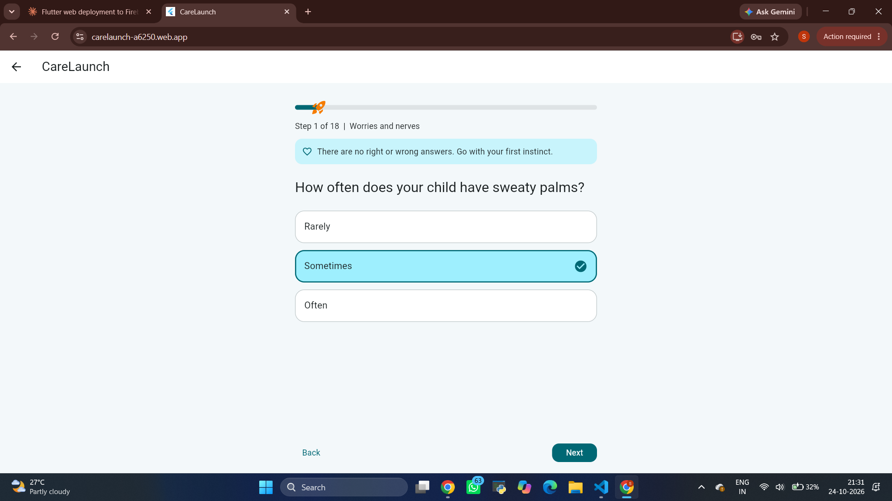
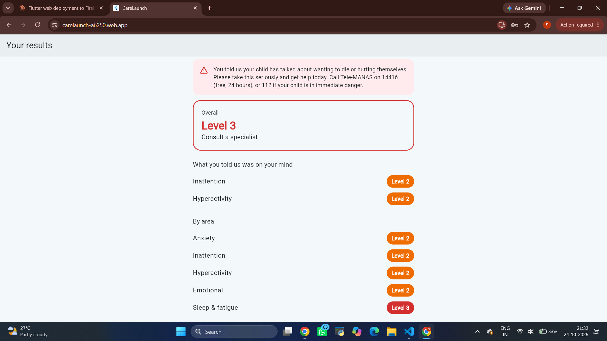
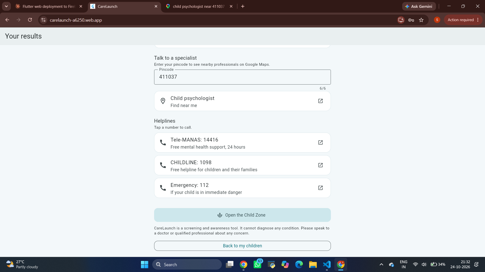
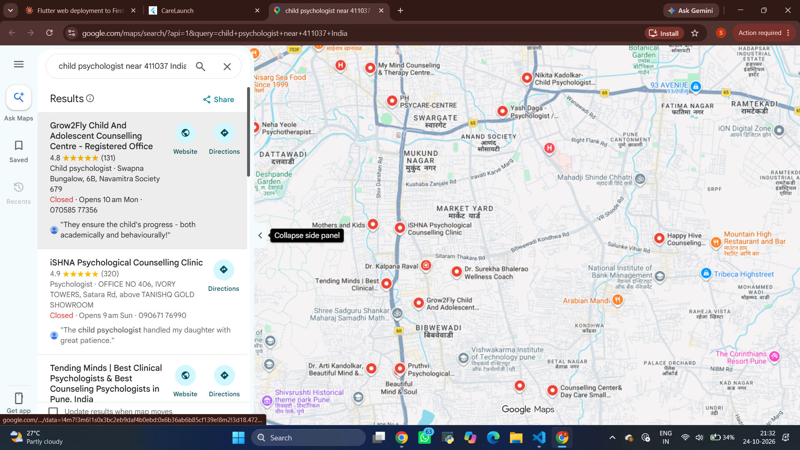
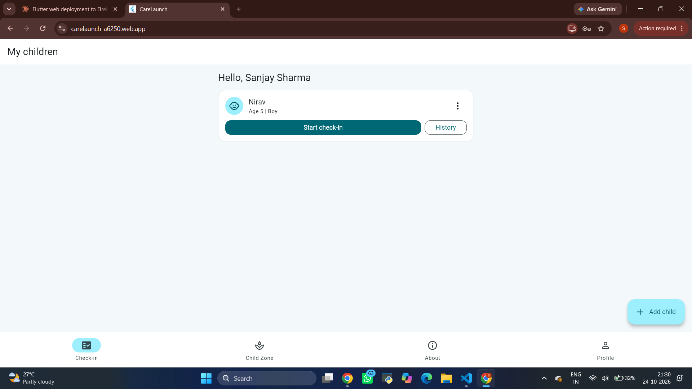
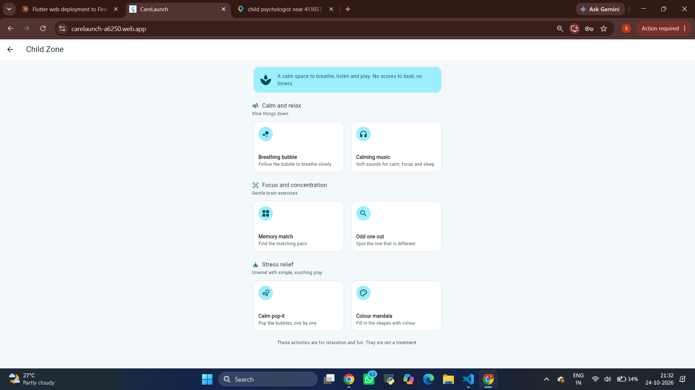
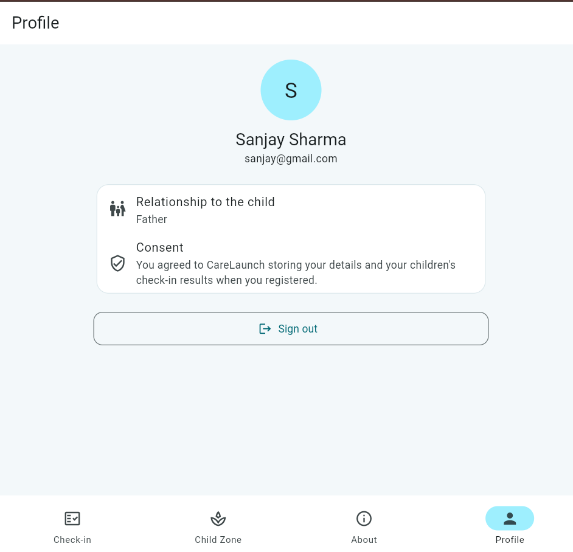

# CareLaunch

A Flutter and Firebase app that helps parents and caregivers of children aged 5 to 14 **screen for emotional and behavioural concerns**, get **age-based guidance**, find **specialist help near them**, and **track check-ins over time**. It also has a calming **Child Zone** with music and games.

> CareLaunch is a screening and guidance tool. It is **not a diagnosis** and does not replace a doctor or psychologist.

## Links

| | |
|---|---|
| Live demo (web) | https://carelaunch-a6250.web.app |
| Android APK | https://github.com/vedantnerkar18-dev/CareLaunch_apk/releases/download/v1.0.0/app-release.apk |

**Demo account:** `sanjay@gmail.com` / `sanjay123` (a sample child is already added)

> Tip for the web demo: browsers only play sound after a tap, so tap a music track once in the Child Zone.

## Screenshots

| Check-in question | Result | Guidance | Nearby specialists |
|---|---|---|---|
|  |  |  |  |

| Child history | Child Zone | Profile |
|---|---|---|
|  |  |  |

## What it does

1. **Register with consent.** A caregiver creates an account, agrees to a plain-language consent note, and adds one or more children (first name or nickname, date of birth, optional gender and home language).
2. **Take a check-in.** After a short introduction (what to expect, privacy, "not a diagnosis"), the parent answers 18 quick questions: 13 scored questions across five areas, plus 5 questions about the bigger picture.
   - Worries and nerves
   - Focus
   - Energy and restlessness
   - Mood and feelings
   - Sleep and tiredness
3. **See a clear result.** Each area, and the child overall, is placed in one of three levels:
   - **Level 1:** support at home
   - **Level 2:** guided support
   - **Level 3:** consult a specialist
4. **Get guidance that fits.**
   - Home tips written for three age bands (5 to 8, 9 to 11, 12 to 14)
   - Video and product searches for the areas that matter
   - Nearby specialists by pincode (opens Google Maps)
   - Tappable helplines: Tele-MANAS 14416, CHILDLINE 1098, and 112 for emergencies
5. **Track progress.** Every check-in is saved to that child's history.
6. **Child Zone.** Calming and focus activities for the child:
   - Breathing bubble
   - Calming music: seven original instrumental loops (calm, focus and sleep)
   - Memory match, Odd one out, Calm pop-it and Colour mandala

## How the scoring works

- A **fuzzy-logic engine** turns the answers into a score and a level for each area, which avoids hard cut-offs between levels.
- A **rules layer** then adjusts the result using context: how long the concern has lasted, how many settings it appears in, how much it affects daily life, and whether there is a safety concern. A safety concern always raises the result to Level 3 and shows helplines.
- The recommendation engine is plain Dart with no UI code, so it is unit tested.

## Privacy and safety choices

- Only the **result levels** of each check-in are saved. The individual answers are not stored.
- Each caregiver can read and write **only their own data** (see the Firestore rules below).
- A child's profile and all their check-ins can be removed at any time.
- Data minimisation: no surname, no school, no photos.
- Helplines appear whenever the result is Level 3 or a safety concern is reported.

## Tech

- **Flutter** (Material 3, a custom teal and white theme) and **Dart**
- **Firebase Authentication** (email and password), **Cloud Firestore** and **Firebase Hosting**
- **Provider** for state, `url_launcher` for links and calls, `audioplayers` for music
- Unit tests for the scoring engine, rules, recommendations, models and game logic

## Project structure

```
lib/
  data/        question bank, tips, music list
  logic/       fuzzy engine, scorer, rules, recommendation engine
  models/      child, caregiver, screening record, severity levels
  games/       pure game logic (memory, odd one out, mandala)
  screens/     login, home tabs, check-in, result, Child Zone, games
  services/    auth and Firestore repository
  theme/       app theme
  widgets/     shared widgets
test/          unit tests
assets/audio/  original music loops
```

## Run it

```bash
flutter pub get
flutter test
flutter run
```

To use your own Firebase project, run `flutterfire configure`, enable **Email/Password** sign-in and create a **Firestore** database, then publish these rules:

```
rules_version = '2';
service cloud.firestore {
  match /databases/{database}/documents {
    match /users/{uid}/{document=**} {
      allow read, write: if request.auth != null && request.auth.uid == uid;
    }
  }
}
```

## Build and deploy

**Android APK**

```bash
flutter build apk --release
```

**Web (Firebase Hosting)**

```bash
flutter build web --release
firebase init hosting     # first time only
firebase deploy --only hosting
```

During `firebase init hosting`:

- Use your existing Firebase project.
- Set the public directory to `build/web`.
- Configure as a single-page app: **Yes**.
- Automatic GitHub builds: **No**.
- If asked to overwrite `build/web/index.html`: **No**.

Your `firebase.json` should contain `"public": "build/web"` and a rewrite of all URLs to `/index.html`. Add `.firebase/` to `.gitignore` so Firebase's cache is not committed.

## Roadmap

- Account deletion and profile editing
- Email verification
- Hindi and Marathi
- More games and a sleep timer for the music
- Try the WebAssembly (`--wasm`) web build
- A reviewed privacy policy and Play Store release

## Author

Vedant Nerkar